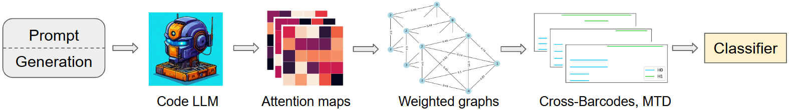

# CodeTD

The repository contains the implementation for the paper:

📄 **Publication**: “CodeTD: Topology of Attention Detects Hallucinations in Code LLMs”  
👥 **Authors**: D. Voronkova, I. Trofimov, A. Dmitriev, E. Tulchinskii, E. Burnaev, S. Barannikov  
🌍 **Conference**: EMNLP 2026 Main, Oral  
🔗 **Link**: https://aclanthology.org/2026.emnlp-main.529.pdf

---

## 💡 Introduction



We introduce CodeTD — the first approach to pre-execution assessment of code correctness based on topological data analysis (TDA) of Code LLMs' attention maps. Our method quantifies prompt-generation mismatch using topological patterns of attention maps. In the paper we carry out experiments with common benchmarks (HumanEval, MBPP, BigCodeBench, MultiPL-E), 5 programming languages and 10 Code LLMs of size up to 34B parameters. The experimental results show that the proposed method outperforms recent baselines. Moreover, CodeTD is transferable between coding benchmarks.

**Scope of this repository.** The code reproduces the **HumanEval** and **MBPP** (Python) experiments: generation with feature extraction, correctness labels, and the classifier, including cross-benchmark transfer between the two.

## 🛠️ Environment Setup

To run the framework, set up your environment as follows:

```bash
conda env create -f environment.yml
conda activate codetd
```
Datasets are downloaded automatically from the Hugging Face Hub: `openai/openai_humaneval` (164 problems) and `google-research-datasets/mbpp` (test split, 500 problems).

## 💻 Usage

The pipeline has two steps:

1. **Generate** code samples and extract attention features (`generate_features.py`).
2. **Train** the classifier and compute ROC AUC (`main_results.ipynb`).

### 1. Generation with feature extraction

```bash
OUT=output/<model_name>/humaneval

python src/generate_features.py \
    --model <model_name> \
    --task humaneval \
    --max_length_generation 512 \
    --do_sample --temperature 0.8 --top_p 0.95 \
    --batch_size 5 --n_batches 5 \
    --precision bf16 \
    --gen_path $OUT/generation.jsonl \
    --compute_features --num_of_workers 4 \
    --scores_path $OUT/scores \
    --diag_prompt_path $OUT/diag_prompt \
    --diag_response_path $OUT/diag_response \
    --mtd0_kind0_path $OUT/mtd0_kind0 \
    --mtd1_kind0_path $OUT/mtd1_kind0 \
    --mtd0_kind1_path $OUT/mtd0_kind1 \
    --mtd1_kind1_path $OUT/mtd1_kind1
```
For MBPP use `--task mbpp` and `--max_length_generation 256` (add `--two_shot` for the two-shot prompt).

#### Main arguments

| Argument | Default | Description |
|---|---|---|
| `--model` | required | Hugging Face model id or local path |
| `--task` | `humaneval` | `humaneval` or `mbpp` |
| `--do_sample` | off | Sample instead of greedy decoding (greedy requires `--batch_size 1`) |
| `--temperature`, `--top_p` | 0., 0.95 | Sampling parameters |
| `--max_length_generation` | 512 | HumanEval: max total length (prompt + generation); MBPP: max new tokens |
| `--precision` | `fp16` | `fp16` or `bf16` |
| `--batch_size` | 1 | Sequences generated per prompt in one call |
| `--n_batches`, `--start_batch` | 1, 0 | Number of batches per problem and index of the first batch; batch `i` uses seed `i` |
| `--gen_path` | required | Output `.jsonl` file |
| `--compute_features` | off | Extract features (requires all `--*_path` arguments and `--num_of_workers`) |

#### Output

##### Generations

One JSON record per generated sequence. Records are **appended** to the file, so remove it before re-running the same configuration. Each record contains the dataset fields of the problem.

##### Features

One `.npy` file per feature and sequence, named `task_id_<task_id>_seed_<seed>_gen_num_<gen_num>.npy`. `S` is the full sequence length, `L` the number of layers, `H` the number of heads.

| Directory | Shape | Description |
|---|---|---|
| `scores` | `(S,)` | Probability of each token under the model's raw logits; prompt positions are 1.0 |
| `diag_prompt` | `(L·H,)` | Sum of the attention-diagonal entries over prompt positions, per (layer, head), layer-major |
| `diag_response` | `(L·H,)` | Same over response positions |
| `mtd0_kind0`, `mtd1_kind0` | `(L, H)` | MTD₀ / MTD₁ with the prompt block set to 0 |
| `mtd0_kind1`, `mtd1_kind1` | `(L, H)` | MTD₀ / MTD₁ with the response block set to 0 |

### 2. Training Classifier

Example of classifier training is in the 'main_results.ipynb'.

## Attribution

`code_eval.py` and `execute.py` are copied from [bigcode-evaluation-harness](https://github.com/bigcode-project/bigcode-evaluation-harness/tree/6116c6a9a5672c69bd624373cfbc8938b7acc249) (Apache License 2.0) and are needed to evaluate the generated
code. `execute.py` is unchanged; in `code_eval.py` only the relative import of `execute` was replaced by an absolute one.

## 📖 Citation

If you find our work useful for your research, please cite it as follows:

```bibtex
@inproceedings{voronkova2026codetd,
    title = "{C}ode{TD}: Topology of Attention Detects Hallucinations in Code {LLM}s",
    author = "Voronkova, Daria and Trofimov, Ilya and Dmitriev, Anton and Tulchinskii, Eduard and Burnaev, Evgeny and Barannikov, Serguei",
    booktitle = "Proceedings of the 2026 Conference on Empirical Methods in Natural Language Processing",
    year = "2026",
    url = "https://aclanthology.org/2026.emnlp-main.529/",
}
```
